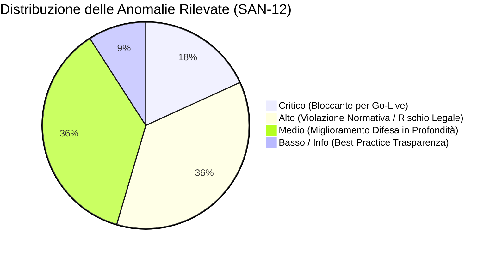

# SAN-12: Audit di Sicurezza Pre-Lancio, Conformità GDPR/PCI-DSS e Privacy

**Progetto**: E-Commerce Shopify Just in Time di Benegiamo Andrea (Muro Leccese, LE)  
**Task ID**: `SAN-12`  
**Ruolo**: Toby — Security Engineer (`worker-toby-security`)  
**Data Audit**: 24 Ottobre 2026  
**Ambito di Verifica**: Codice sorgente tema Dawn, Prototipo interattivo (`preview/index.html`), Pagine legali (`pages-legal/`), Flussi di pagamento, Cookie e Tracciamento, Politiche di Recesso/Reso, Mitigazione Rischi Account e Canali WhatsApp  
**Standard e Normative di Riferimento**:
- **PCI-DSS v4.0** (Payment Card Industry Data Security Standard - Perimetro SAQ A e gestione transazioni)
- **Regolamento UE 2016/679 (GDPR)** & **D.Lgs. 196/2003** novellato dal **D.Lgs. 101/2018**
- **Linee Guida Cookie e altri strumenti di tracciamento del Garante Privacy** (10 giugno 2021, doc. web n. 9677876)
- **Codice del Consumo (D.Lgs. 206/2005)** come modificato dal **D.Lgs. 21/2014** e **D.Lgs. 26/2023** (Direttiva Omnibus)
- **Decreto Commercio Elettronico (D.Lgs. 70/2003)** e **Art. 2250 Codice Civile**
- **NIST SP 800-63B** (Digital Identity Guidelines: Authentication and Lifecycle Management)

---

## 1. Executive Summary & Verdetto di Sicurezza

L'audit di sicurezza pre-lancio condotto sul progetto e-commerce di **Just in Time di Benegiamo Andrea** ha valutato la postura di sicurezza complessiva, la conformità normativa e la tutela dei dati personali prima del go-live pubblico su piattaforma Shopify.

L'adozione dell'architettura **Shopify SaaS** offre un'eccellente linea di difesa perimetrale nativa:
- Livello di conformità **PCI-DSS Level 1** per l'infrastruttura di pagamento;
- Crittografia end-to-end con certificati TLS 1.3 emessi e rinnovati automaticamente su CDN globale;
- Isolamento del checkout e conformità alle direttive europee PSD2 / Strong Customer Authentication (SCA 3D Secure 2.0).

Tuttavia, l'analisi puntuale dei deliverable locali (prototipo storefront `preview/index.html`, testi legali `pages-legal/`, configurazioni tema e flussi operativi omnicanale WhatsApp) ha evidenziato **11 anomalie di sicurezza e conformità**, di cui **2 a gravità Critica**, **4 ad Alta gravità**, **4 a Media gravità** e **1 Bassa/Informativa**.

### Matrice di Sintesi dei Rischi Rilevati



| ID Rischio | Livello | Categoria | Titolo / Descrizione Sintetica | File / Componente Coinvolto |
| :--- | :---: | :---: | :--- | :--- |
| **SEC-01** | **CRITICO** | GDPR / Garante | **Assenza di Cookie Banner e Mancato Blocco Preventivo dei Tracciatori** | `preview/index.html`, `shopify-theme/` |
| **SEC-02** | **CRITICO** | PCI-DSS / Sicurezza | **Rischio Trasmissione Estremi Pagamento e Dati Ordine via Canale WhatsApp** | `preview/index.html` (L1229-1245) |
| **SEC-03** | **ALTO** | Codice Consumo | **Omissione Modulo di Recesso Tipo e Mancata Indicazione Spese di Restituzione** | `pages-legal/termini-condizioni-e-recesso.html` |
| **SEC-04** | **ALTO** | Normativa E-Commerce | **Mancata Pubblicazione P.IVA Effettiva, C.F., REA e PEC nel Footer e Note** | `preview/index.html` (L847), `pages-legal/` |
| **SEC-05** | **ALTO** | Tutela Consumatore | **Assenza Link alla Piattaforma Europea Risoluzione Controversie Online (ODR/ADR)** | `pages-legal/termini-condizioni-e-recesso.html` |
| **SEC-06** | **ALTO** | Sicurezza Account | **Rischio Credential Stuffing & Raccomandazione Passwordless OTP (New Accounts)** | Configurazione Shopify Admin |
| **SEC-07** | **MEDIO** | GDPR / Privacy | **Broken Link su Cookie Policy e Omissione del Diritto di Reclamo al Garante** | `preview/index.html` (L840), `pages-legal/` |
| **SEC-08** | **MEDIO** | Gestione Accessi | **Protezione Account Amministratore Shopify (2FA via App) e Sicurezza POS Locale** | Shopify Admin & Banco C&C Via Corsica |
| **SEC-09** | **MEDIO** | Frontend Security | **Rischio Reverse Tabnabbing (`rel="noopener noreferrer"`) nei Link Footer** | `preview/index.html` (L839-843) |
| **SEC-10** | **MEDIO** | Privacy & Spedizioni | **Disciplina GDPR dei Contatti WhatsApp e Divieto di Broadcast Promozionali Spontanei** | Flussi WhatsApp (SAN-10) e Policy |
| **SEC-11** | **BASSO** | Codice Consumo | **Accettazione Espressa della Garanzia 12 Mesi sui Beni Ricondizionati** | `pages-legal/termini-condizioni-e-recesso.html` |

---

## 2. Analisi Dettagliata delle Anomalie (Findings)

Conformemente al mandato del Security Engineer, per ciascun elemento vengono dettagliati: **il file/componente interessato**, **il livello di rischio**, **la procedura di prova/riproduzione** e **la soluzione tecnica/legale (fix) raccomandata**. In accordo con il principio di indipendenza dell'audit, **nessun file di produzione è stato alterato unilateralmente**; le correzioni sono fornite in formato pronto per l'implementazione.

---

### SEC-01 [CRITICO]: Assenza di Cookie Banner e Mancato Blocco Preventivo dei Tracciatori
* **File Coinvolto**: `preview/index.html` e template Shopify (`shopify-theme/layout/theme.liquid`)
* **Livello di Rischio**: **CRITICO** (Violazione formale art. 122 D.Lgs. 196/2003 e Linee Guida Garante Privacy del 10 giugno 2021).
* **Rischio & Vulnerabilità**:
  Nel prototipo e nelle sezioni base del tema non è presente alcuna interfaccia di consenso (Cookie Banner). Se lo store attiva pixel di tracciamento o script di profilazione (es. Meta Pixel da SAN-10 per Instagram Shopping o Google Analytics 4) senza bloccarli preventivamente prima dell'azione positiva dell'utente, l'installazione è **illecita ab origine**. Le sanzioni amministrative pecuniarie previste dall'art. 83 del GDPR possono raggiungere i 20 milioni di euro o fino al 4% del fatturato annuo globale.
* **Come Provare l'Anomalia**:
  1. Aprire `preview/index.html` in modalità navigazione in incognito.
  2. Verificare che la pagina viene renderizzata senza proporre alcun banner di gestione cookie.
  3. Nel footer (riga 840) è presente un link a "Cookie Policy" ma non vi è traccia di registro di consenso, né di pulsante "Rifiuta tutti", né di meccanismo per revocare le preferenze precedentemente espresse.
* **Soluzione Tecnica (Fix)**:
  1. **Nello Store Shopify Partner/Produzione**: Attivare il banner nativo gratuito di Shopify andando su **Admin > Impostazioni > Privacy del cliente > Banner per i cookie**. Selezionare l'opzione *"Raccolta consentita solo dopo l'accettazione"* (Regioni: UE/SEE, Regno Unito, Svizzera).
  2. **Caratteristiche di Conformità Garante Privacy 2021**:
     - Presenza di un pulsante **"Accetta tutti"** e di un pulsante **"Rifiuta tutti"** (o continua senza accettare) posizionati con pari risalto grafico e cromatico;
     - Presenza della **"X" di chiusura** in alto a destra, il cui click equivale per legge al mantenimento delle impostazioni di default (solo cookie tecnici);
     - Sezione per la scelta granulare delle finalità (Cookie Tecnici, Analitici anonimizzati, Marketing/Profilazione);
     - Registro del consenso per almeno 6 mesi prima di poter riproporre il banner all'utente.
  3. **Snippet di Riferimento per il Prototipo / Storefront Locale**:
     ```html
     <!-- Snippet Cookie Consent Conforme Garante Privacy -->
     <div id="jitCookieBanner" class="jit-cookie-banner" role="dialog" aria-labelledby="jitCookieTitle" style="display:none; position:fixed; bottom:0; left:0; right:0; background:#1e293b; color:#fff; padding:20px; z-index:99999; box-shadow:0 -4px 20px rgba(0,0,0,0.15);">
       <div style="max-width:1200px; margin:0 auto; display:flex; flex-wrap:wrap; justify-content:space-between; align-items:center; gap:16px;">
         <div style="flex:1 1 600px; font-size:13px; line-height:1.5;">
           <strong id="jitCookieTitle" style="font-size:15px; color:#f59e0b;">Informativa sull'uso dei Cookie</strong><br>
           Noi e terze parti selezionate utilizziamo cookie e tecnologie simili per garantire il corretto funzionamento del sito e, previo tuo consenso, per finalità di profilazione e marketing personalizzato come specificato nella nostra <a href="../pages-legal/informativa-privacy-gdpr.html#cookie" style="color:#f59e0b; text-decoration:underline;">Cookie Policy</a>. Puoi liberamente prestare, rifiutare o revocare il consenso in qualsiasi momento. La chiusura del banner mediante la 'X' in alto a destra comporta il permanere delle impostazioni predefinite (soli cookie tecnici necessari).
         </div>
         <div style="display:flex; gap:10px; align-items:center;">
           <button id="btnRejectCookie" style="background:transparent; border:1px solid #94a3b8; color:#fff; padding:8px 16px; border-radius:6px; cursor:pointer; font-weight:600;">Rifiuta tutti</button>
           <button id="btnAcceptCookie" style="background:#f59e0b; border:none; color:#1e293b; padding:8px 18px; border-radius:6px; cursor:pointer; font-weight:700;">Accetta tutti</button>
           <button id="btnCloseCookie" aria-label="Chiudi e rifiuta non tecnici" style="background:none; border:none; color:#94a3b8; font-size:20px; cursor:pointer; margin-left:10px;">✕</button>
         </div>
       </div>
     </div>
     <script>
       (function() {
         var consent = localStorage.getItem('jit_cookie_consent');
         if (!consent) {
           document.getElementById('jitCookieBanner').style.display = 'block';
         }
         function setConsent(status) {
           localStorage.setItem('jit_cookie_consent', status);
           localStorage.setItem('jit_cookie_consent_date', new Date().toISOString());
           document.getElementById('jitCookieBanner').style.display = 'none';
         }
         document.getElementById('btnAcceptCookie').onclick = function() { setConsent('all'); };
         document.getElementById('btnRejectCookie').onclick = function() { setConsent('technical_only'); };
         document.getElementById('btnCloseCookie').onclick = function() { setConsent('technical_only'); };
       })();
     </script>
     ```

---

### SEC-02 [CRITICO]: Rischio Trasmissione Estremi di Pagamento e Dati Ordine via Canale WhatsApp
* **File Coinvolto**: `preview/index.html` (righe 1229-1245, funzione `checkoutSimulate()`)
* **Livello di Rischio**: **CRITICO** (PCI-DSS v4.0 Requirement 4.2 e GDPR art. 32).
* **Rischio & Vulnerabilità**:
  Nel prototipo corrente, la simulazione del checkout termina con l'invito: *"Vuoi inviare la richiesta di prenotazione via WhatsApp direttamente ad Andrea?"*. L'URL viene aperto tramite `https://wa.me/393206025789?text=...` serializzando l'intero carrello e le modalità in query string.
  Se un cliente interpreta questa funzione come modalità d'acquisto e risponde via chat fornendo il numero della propria carta di credito, scadenza e CVV, si determinano due violazioni gravissime:
  1. **PCI-DSS Requirement 4.2**: Divieto assoluto di trasmettere numeri di carte di pagamento (PAN primario) tramite tecnologie di messaggistica per utenti finali non protette;
  2. **Espansione del perimetro PCI**: Lo store perderebbe la qualifica semplificata **SAQ A** (gestione esclusiva da parte di provider certificato Level 1 come Shopify Payments) ed entrerebbe nel perimetro **SAQ D**, che impone audit infrastrutturali completi, vulnerability scan trimestrali e penali dai circuiti interbancari in caso di data breach.
* **Come Provare l'Anomalia**:
  1. In `preview/index.html`, aggiungere un prodotto al carrello e cliccare su *"Procedi con l'Ordine"*.
  2. Cliccare *"OK"* al prompt di conferma.
  3. Viene richiamata la stringa: `https://wa.me/393206025789?text=Ciao%20Andrea...`.
  4. Nessun avviso di sicurezza informa l'utente di non inserire dati finanziari, coordinate bancarie o documenti personali nella chat.
* **Soluzione Tecnica (Fix)**:
  1. **Regola Operativa Ferrea**: Tutti i pagamenti digitali (Carte, Bancomat, Apple Pay, Google Pay, PayPal) devono transitare **esclusivamente dallo Shopify Hosted Checkout** nativo protetto da crittografia HTTPS TLS 1.3 e conformità PCI-DSS Livello 1.
  2. **Per il Ritiro in Sede (Click & Collect)**: Il pagamento locale al banco deve avvenire fisicamente tramite contanti o terminale POS bancario fisico certificato (POS fisico isolato con mascheramento dello scontrino).
  3. **Disclaimer di Sicurezza nel Payload WhatsApp**: Aggiornare il messaggio precompilato e il dialog a video inserendo un alert chiaro:
     ```javascript
     // Correzione di sicurezza in preview/index.html
     function checkoutSimulate() {
       if (cart.length === 0) {
         alert("Il carrello è vuoto.");
         return;
       }
       const method = document.querySelector('input[name="deliveryMethod"]:checked').value;
       const isPickup = (method === 'pickup');
       const itemsList = cart.map(i => `- ${i.qty}x ${i.title} (€${(i.price * i.qty).toFixed(2)})`).join('\n');
       const total = document.getElementById('cartTotalDisplay').innerText;

       const notice = "AVVISO DI SICUREZZA:\nPer la tua tutela, non comunicare MAI numeri di carta di credito, codici CVV o PIN via chat. I pagamenti elettronici avvengono solo tramite checkout sicuro del sito o al POS fisico in negozio.";
       
       if (confirm(`Riepilogo Ordine:\n${itemsList}\nTotale: ${total}\n\n${notice}\n\nVuoi inoltrare la richiesta di disponibilità ad Andrea via WhatsApp?`)) {
         const text = `Ciao Andrea, vorrei informazioni/disponibilità per questo ordine:\n${itemsList}\nTotale: ${total}\nModalità: ${isPickup ? 'Ritiro in negozio a Muro Leccese' : 'Spedizione a domicilio'}\n(Nota: Pagamento da concordare su cassa protetta o al banco)`;
         window.open(`https://wa.me/393206025789?text=${encodeURIComponent(text)}`, '_blank', 'noopener,noreferrer');
       }
     }
     ```

---

### SEC-03 [ALTO]: Omissione Modulo di Recesso Tipo e Mancata Indicazione Spese di Restituzione
* **File Coinvolto**: `pages-legal/termini-condizioni-e-recesso.html` (righe 20-27) e `pages-legal/PAGINE_ISTITUZIONALI_E_LEGALI_COMPILATE.md`
* **Livello di Rischio**: **ALTO** (Violazione formale Artt. 49 comma 1 lett. h, 53 e 57 comma 1 D.Lgs. 206/2005 - Codice del Consumo).
* **Rischio & Vulnerabilità**:
  1. **Rischio Spese a Carico del Negozio**: Ai sensi dell'art. 57 comma 1 del Codice del Consumo: *"Il consumatore sostiene solo il costo diretto della restituzione dei beni, a meno che il professionista non abbia concordato di sostenerlo o abbia omesso di informare il consumatore che tale costo è a carico del consumatore"*. Non avendo specificato che le spese di spedizione del reso sono a carico del cliente, **Just in Time è obbligata per legge a pagare di tasca propria il corriere di restituzione**.
  2. **Estensione del Recesso a 12 Mesi**: L'art. 53 stabilisce che se il venditore non adempie agli obblighi di informazione sul recesso (incluso il modulo tipo allegato), il termine per il ripensamento del cliente **si estende di ulteriori 12 mesi** (passando da 14 giorni a 1 anno e 14 giorni).
* **Come Provare l'Anomalia**:
  Leggere la sezione *4. Diritto di Recesso* in `pages-legal/termini-condizioni-e-recesso.html`. Mancano il testo standard del modulo di recesso tipo (Allegato I, parte B) e l'attribuzione espressa dell'onere delle spese postali per il rientro della merce.
* **Soluzione Tecnica (Fix)**:
  Aggiornare il punto 4 delle condizioni di vendita inserendo:
  1. La precisazione che le spese dirette di spedizione per la restituzione sono a carico del cliente (eccetto reso gratuito consegnato a mano al banco di Muro Leccese);
  2. Il modulo standard di recesso tipo:
     ```html
     <h4>Spese di Restituzione nel Recesso</h4>
     <p>I costi diretti della restituzione del bene rimangono interamente a carico del cliente consumatore (tariffa forfettaria con corriere convenzionato €6,90 o spedizione autonoma). La restituzione è sempre <strong>totalmente gratuita</strong> qualora il cliente scelga di riconsegnare il prodotto direttamente presso il nostro punto vendita in Via Corsica 151, Muro Leccese.</p>

     <h4>Modulo di Recesso Tipo (Allegato I, parte B, D.Lgs. 206/2005)</h4>
     <p><em>(Compilare e restituire il presente modulo solo se si desidera recedere dal contratto)</em></p>
     <div style="background:#f8fafc; border:1px dashed #cbd5e1; padding:15px; font-size:13px; font-family:monospace;">
       Destinatario: Just in Time di Benegiamo Andrea, Via Corsica 151, 73036 Muro Leccese (LE), email: info@justintimemuro.it<br><br>
       Con la presente io/noi (*) notifichiamo il recesso dal mio/nostro (*) contratto di vendita dei seguenti beni/servizi (*):<br>
       - Ordinato il (*) / Ricevuto il (*): ______________________<br>
       - Numero d'Ordine: ______________________<br>
       - Nome del/dei consumatore(i): ______________________<br>
       - Indirizzo del/dei consumatore(i): ______________________<br>
       - Data e Firma del/dei consumatore(i): ______________________
     </div>
     ```

---

### SEC-04 [ALTO]: Mancata Pubblicazione P.IVA Effettiva, C.F., REA e PEC nel Footer e Note
* **File Coinvolto**: `preview/index.html` (riga 847), `pages-legal/informativa-privacy-gdpr.html` (riga 9), `shopify-theme/config/settings_data.json`
* **Livello di Rischio**: **ALTO** (Violazione Art. 35 comma 1 DPR 633/72, Art. 2250 c.c., e Art. 7 D.Lgs. 70/2003).
* **Rischio & Vulnerabilità**:
  La legge italiana sul commercio elettronico impone l'indicazione chiaramente visibile della **Partita IVA sulla homepage** e su tutte le pagine del sito web. L'omissione è punita con sanzione amministrativa pecuniaria da parte dell'Agenzia delle Entrate da **103 € a 1.032 €** (Art. 35, c. 1, DPR 633/1972). Inoltre, per le ditte individuali o società è obbligatorio esporre il numero di iscrizione al Registro Imprese (REA) e l'indirizzo PEC (Posta Elettronica Certificata).
* **Come Provare l'Anomalia**:
  In `preview/index.html`, riga 847: `<div>© 2026 Just in Time di Benegiamo Andrea - P.IVA Registrata - Tutti i diritti riservati.</div>`. La dicitura *"P.IVA Registrata"* è un mero testo fittizio privo degli 11 caratteri numerici della matricola fiscale. In `informativa-privacy-gdpr.html`, riga 9: *"Partita IVA / C.F.: Dati pubblicati nel footer aziendale"*.
* **Soluzione Tecnica (Fix)**:
  Inserire i dati identificativi effettivi nel footer di Dawn (`theme.liquid` e `settings_data.json`) e nelle pagine legali:
  - Ragione Sociale: **Just in Time di Benegiamo Andrea** (Ditta Individuale)
  - Sede Legale/Operativa: **Via Corsica 151, 73036 Muro Leccese (LE)**
  - **Partita IVA**: `[Numero P.IVA 11 cifre di Andrea]`
  - **Codice Fiscale**: `[Codice Fiscale di Andrea]`
  - **Ufficio del Registro delle Imprese**: CCIAA di Lecce - Numero REA: `[Numero REA]`
  - **Indirizzo PEC**: `[pec@pec.justintimemuro.it]`

---

### SEC-05 [ALTO]: Assenza Link alla Piattaforma Europea Risoluzione Controversie Online (ODR/ADR)
* **File Coinvolto**: `pages-legal/termini-condizioni-e-recesso.html`, `preview/index.html`
* **Livello di Rischio**: **ALTO** (Violazione Art. 14 Regolamento UE n. 524/2013 e Art. 141-sexies Codice del Consumo).
* **Rischio & Vulnerabilità**:
  Tutti i commercianti e-commerce stabiliti nell'Unione Europea che stipulano contratti di vendita online hanno l'obbligo legale di fornire sul proprio sito un **link elettronico facilmente accessibile alla piattaforma ODR** (Online Dispute Resolution) istituita dalla Commissione Europea, corredato dal proprio indirizzo di posta elettronica. La mancata inclusione espone a sanzioni e diffide da parte dell'AGCM (Autorità Garante della Concorrenza e del Mercato).
* **Come Provare l'Anomalia**:
  Eseguire una ricerca all'interno del repository con `grep -i "odr" pages-legal/*`: nessun risultato trovato.
* **Soluzione Tecnica (Fix)**:
  Aggiungere nei Termini e Condizioni e nel footer la seguente clausola:
  ```html
  <h3>5. Risoluzione Online delle Controversie dei Consumatori (ODR)</h3>
  <p>Ai sensi dell'art. 14 del Regolamento UE n. 524/2013, si informa il consumatore che, in caso di controversia insorta in merito all'acquisto effettuato sul presente sito, è possibile presentare un reclamo attraverso la piattaforma ODR (Online Dispute Resolution) istituita dalla Commissione Europea, accessibile all'indirizzo web: <a href="https://ec.europa.eu/consumers/odr" target="_blank" rel="noopener noreferrer">https://ec.europa.eu/consumers/odr</a>. L'indirizzo di contatto di Just in Time per tali procedure è: <strong>info@justintimemuro.it</strong>.</p>
  ```

---

### SEC-06 [ALTO]: Rischio Credential Stuffing & Raccomandazione Passwordless OTP
* **File Coinvolto**: Configurazione Shopify Admin (`Impostazioni > Account cliente`)
* **Livello di Rischio**: **ALTO** (NIST SP 800-63B e tutela account utente).
* **Rischio & Vulnerabilità**:
  L'utilizzo dei tradizionali account utente basati su password ("Classic customer accounts") costituisce uno dei principali vettori di attacco su scala globale (credential stuffing e password spraying derivanti da data breach esterni). Poiché i consumatori riutilizzano le medesime password su decine di siti, gli account Just in Time rischierebbero l'effrazione con furto di indirizzi di consegna salvati o alterazione ordini.
* **Come Provare l'Anomalia**:
  Nella configurazione iniziale standard di uno store Shopify, la modalità di default prevede spesso le credenziali classiche con email e password debole senza autenticazione a più fattori.
* **Soluzione Tecnica (Fix)**:
  Nel pannello Shopify Admin:
  1. Andare su **Impostazioni > Account cliente**;
  2. Sotto la voce *"Versione degli account cliente"*, selezionare **"Nuovi account cliente" (New customer accounts)**;
  3. Questa impostazione attiva nativamente il login **passwordless tramite One-Time Password (OTP)**: l'utente inserisce la propria email e riceve un codice numerico temporaneo a 6 cifre valido per 15 minuti.
  4. **Vantaggi di sicurezza**:
     - Eliminazione del database password lato cliente;
     - Impossibilità di attacchi di forza bruta o credential stuffing;
     - Nessun onere di reset password o recupero credenziali per Andrea;
     - Esperienza utente mobile-first immediata per gli utenti di Muro Leccese.

---

### SEC-07 [MEDIO]: Broken Link su Cookie Policy e Omissione del Diritto di Reclamo al Garante
* **File Coinvolto**: `preview/index.html` (riga 840) e `pages-legal/informativa-privacy-gdpr.html`
* **Livello di Rischio**: **MEDIO** (Inadempimento obblighi di trasparenza Artt. 13 e 77 GDPR).
* **Rischio & Vulnerabilità**:
  1. Il link nel footer punta a `informativa-privacy-gdpr.html#cookie`, ma il file `informativa-privacy-gdpr.html` non contiene alcuna sezione con identificatore `id="cookie"`. L'utente non riceve le informazioni dovute sulla durata di conservazione e tassonomia dei cookie;
  2. L'informativa privacy non menziona espressamente la facoltà dell'interessato di **proporre reclamo all'Autorità Garante per la Protezione dei Dati Personali** (Piazza Venezia 11, Roma), elemento obbligatorio prescritto dall'art. 13 comma 2 lett. d) del GDPR.
* **Come Provare l'Anomalia**:
  In `preview/index.html`, cliccare sul link *"Cookie Policy"*: la pagina si apre in cima senza scrollare ad alcuna sezione dedicata, poiché l'ancora `#cookie` è assente nel markup HTML.
* **Soluzione Tecnica (Fix)**:
  1. Inserire in `pages-legal/informativa-privacy-gdpr.html` la sezione dedicata con ancoraggio esplicito `<div id="cookie">` contenente la tabella dei cookie di sessione e sicurezza di Shopify (`cart_currency`, `secure_customer_sig`, `_shopify_s`, `_shopify_y` con durata 1-2 anni);
  2. Aggiungere al paragrafo *5. Diritti dell'Interessato* la dicitura:
     ```html
     <p>Qualora ritenga che il trattamento dei suoi dati personali violi le disposizioni del Regolamento UE 2016/679, l'interessato ha il diritto di proporre reclamo formale al <strong>Garante per la Protezione dei Dati Personali</strong> (Piazza Venezia 11, 00187 Roma - www.garanteprivacy.it), o di adire le opportune sedi giudiziarie (art. 77 GDPR).</p>
     ```

---

### SEC-08 [MEDIO]: Protezione Account Amministratore Shopify (2FA via App) e Sicurezza POS Locale
* **File Coinvolto**: Account Shopify Admin (Andrea Benegiamo) e postazione fisica cassa (Via Corsica 151)
* **Livello di Rischio**: **MEDIO** (PCI-DSS Requirement 8.3 & ISO/IEC 27001).
* **Rischio & Vulnerabilità**:
  L'account principale del titolare ha poteri assoluti sullo store: coordinate bancarie di accredito dei payout, export dell'intero database clienti (PII) e installazione di applicazioni terze. Un eventuale accesso non autorizzato causerebbe il sequestro o la frode finanziaria sul negozio. Parallelamente, sul banco cassa a Muro Leccese, lo scontrino POS stampato o la postazione di gestione non devono esporre credenziali o numeri di carta.
* **Come Provare l'Anomalia**:
  Spesso gli amministratori di store Shopify utilizzano l'autenticazione via SMS (soggetta ad attacchi SIM Swapping) oppure disabilitano il blocco automatico dello schermo sul PC al banco vendita.
* **Soluzione Tecnica (Fix)**:
  1. **Autenticazione a Due Fattori (MFA/2FA) Obbligatoria**: Andrea deve configurare l'accesso a Shopify Admin esclusivamente tramite app di autenticazione time-based (TOTP come Google Authenticator, 1Password o Apple Keychain), disattivando l'SMS come canale di recupero primario;
  2. **Configurazione Account di Staff a Privilegi Minimi**: Se in futuro Andrea delega attività operative a collaboratori di negozio o familiari, creare utenze staff distinte con permessi limitati alla sola consultazione ordini ed evasione spedizioni, vietando tassativamente l'accesso a Impostazioni Finanziarie, Payout e Modifica Temi;
  3. **Misure Fisiche al Banco di Via Corsica**:
     - Schermo del PC o tablet di cassa protetto da timeout blocco automatico a 5 minuti;
     - Terminale POS conforme alle norme di mascheramento PAN (stampa sullo scontrino delle sole prime 6 e ultime 4 cifre della carta);
     - Divieto di trascrivere codici PIN o estremi di carte clienti su registri cartacei.

---

### SEC-09 [MEDIO]: Rischio Reverse Tabnabbing (`rel="noopener noreferrer"`) nei Link Footer
* **File Coinvolto**: `preview/index.html` (righe 839-843)
* **Livello di Rischio**: **MEDIO** (Vulnerabilità Frontend OWASP Client-Side Phishing).
* **Rischio & Vulnerabilità**:
  Nel footer di `preview/index.html`, i link verso le pagine esterne ed informative utilizzano l'attributo `target="_blank"` senza specificare l'attributo `rel="noopener noreferrer"`. Nei browser web non recentissimi, la pagina aperta in una nuova scheda ottiene l'accesso parziale alla pagina di origine attraverso la proprietà JavaScript `window.opener`. Un'eventuale pagina compromessa o redirect malevolo potrebbe modificare la URL della pagina originaria (`window.opener.location = 'phishing-url'`), ingannando l'utente.
* **Come Provare l'Anomalia**:
  Ispezione del file `preview/index.html`:
  ```html
  <li><a href="../pages-legal/informativa-privacy-gdpr.html" target="_blank">Informativa Privacy (GDPR)</a></li>
  ```
  Manca l'attributo `rel="noopener noreferrer"`.
* **Soluzione Tecnica (Fix)**:
  Aggiornare tutti i tag `<a>` con `target="_blank"` aggiungendo `rel="noopener noreferrer"`:
  ```html
  <li><a href="../pages-legal/informativa-privacy-gdpr.html" target="_blank" rel="noopener noreferrer">Informativa Privacy (GDPR)</a></li>
  <li><a href="../pages-legal/informativa-privacy-gdpr.html#cookie" target="_blank" rel="noopener noreferrer">Cookie Policy</a></li>
  <li><a href="../pages-legal/termini-condizioni-e-recesso.html" target="_blank" rel="noopener noreferrer">Termini di Vendita e Recesso</a></li>
  <li><a href="../pages-legal/ritiro-in-sede-e-spedizioni.html" target="_blank" rel="noopener noreferrer">Condizioni Ritiro in Sede</a></li>
  ```
  *(Nota: nel codice Liquid di `shopify-theme/snippets/whatsapp-widget.liquid` l'attributo `rel="noopener noreferrer"` è già stato correttamente implementato).*

---

### SEC-10 [MEDIO]: Disciplina GDPR dei Contatti WhatsApp e Divieto di Broadcast Promozionali Spontanei
* **File Coinvolto**: Strategia social/WhatsApp (SAN-10), snippet widget e privacy policy
* **Livello di Rischio**: **MEDIO** (Art. 6 GDPR e Art. 130 D.Lgs. 196/2003 - Comunicazioni indesiderate).
* **Rischio & Vulnerabilità**:
  Nel piano operativo SAN-10 è prevista una stretta integrazione con WhatsApp Business per supportare il Click & Collect e inviare promozioni locali.
  Tuttavia, ai sensi dell'art. 130 del Codice Privacy, il numero di telefono cellulare acquisito in occasione di una richiesta di informazioni o di un ordine non può essere utilizzato per l'invio di messaggi promozionali, offerte volantino o liste broadcast automatizzate senza un **previo ed esplicito consenso marketing opzionale (opt-in)**. L'invio non autorizzato configura spam sanzionabile. Inoltre, i backup di WhatsApp sul telefono di Andrea devono essere protetti.
* **Come Provare l'Anomalia**:
  In assenza di una casella di spunta separata per il marketing WhatsApp al momento dell'ordine, l'inclusione automatica del cliente in campagne broadcast sarebbe contraria alla legge.
* **Soluzione Tecnica (Fix)**:
  1. **Separazione delle Basi Giuridiche**:
     - *Comunicazioni di servizio/ordine*: lecite in base all'esecuzione del contratto (art. 6.1.b GDPR);
     - *Comunicazioni commerciali/promozionali*: permesse solo previo consenso separato e inequivocabile (art. 6.1.a GDPR);
  2. **Backup e Sicurezza del Dispositivo WhatsApp**: Andrea deve attivare sul dispositivo mobile aziendale il blocco con impronta/FaceID per l'accesso a WhatsApp Business e la crittografia end-to-end dei backup cloud (Google Drive / iCloud);
  3. **Nomina Meta**: Inserire nella Privacy Policy la menzione di Meta Platforms Ireland Ltd. quale fornitore dell'infrastruttura di messaggistica istantanea.

---

### SEC-11 [BASSO]: Accettazione Espressa della Garanzia 12 Mesi sui Beni Ricondizionati
* **File Coinvolto**: `pages-legal/termini-condizioni-e-recesso.html` (riga 16) e schede prodotto
* **Livello di Rischio**: **BASSO / INFORMATIVO** (Art. 133 comma 4 D.Lgs. 206/2005 - Codice del Consumo).
* **Rischio & Vulnerabilità**:
  La normativa italiana stabilisce che la garanzia legale di conformità per i beni di consumo è di 24 mesi. L'art. 133 comma 4 consente di limitarla a **1 anno per i beni usati o ricondizionati**, purché vi sia un **accordo espresso** tra le parti. Una clausola standard generica non evidenziata potrebbe essere considerata clausola vessatoria o inefficace in caso di contenzioso, esponendo il venditore ai 2 anni ordinari.
* **Come Provare l'Anomalia**:
  In `termini-condizioni-e-recesso.html`, punto 3: *"I prodotti ricondizionati certificati godono di una garanzia commerciale convenzionale di 12 mesi prestata direttamente dal nostro laboratorio"*. Manca una chiara indicazione sull'accettazione specifica al momento dell'acquisto.
* **Soluzione Tecnica (Fix)**:
  1. Nelle schede dei prodotti ricondizionati (es. notebook usati/aziendali), specificare in modo trasparente: *"Prodotto ricondizionato Grado A+ certificato - Garanzia legale concordata 12 mesi ai sensi dell'art. 133 co. 4 Codice del Consumo"*;
  2. Inserire nel riepilogo del checkout o nell'email di conferma ordine la nota esplicita con la durata della garanzia convenzionale concordata.

---

## 3. Matrice di Conformità Normativa & Checklist Pre-Lancio

| Norma / Standard | Requisito Chiave | Stato Attuale | Azione Richiesta per Go-Live | Esito Pre-Audit |
| :--- | :--- | :---: | :--- | :---: |
| **PCI-DSS v4.0 (SAQ A)** | Crittografia transazioni e isolamento iframe carte | ⚠️ Da completare | Bloccare ricezione dati pagamento via WhatsApp; affidare tutto a Shopify Checkout | 🟡 CON RISERVA |
| **Garante Privacy (10/06/21)** | Blocco preventivo cookie profilazione & Banner con 'X' e 'Rifiuta' | ❌ Non conforme | Attivare Customer Privacy Banner di Shopify o snippet conforme fornito | 🔴 NON CONFORME |
| **GDPR (Artt. 13-14)** | Informativa completa con P.IVA, PEC, DPO e reclamo Garante | ⚠️ Parziale | Inserire P.IVA, REA, PEC e diritto reclamo Garante Privacy | 🟡 DA AGGIORNARE |
| **Codice Consumo (Art. 49-57)** | Modulo recesso tipo e attribuzione spese spedizione reso | ❌ Incompleto | Inserire modulo allegato I parte B e clausola spese reso a carico cliente | 🔴 NON CONFORME |
| **Codice Consumo (Art. 133)** | Garanzia legale 24 mesi nuovi / 12 mesi ricondizionati con accordo | ⚠️ Parziale | Esplicitare accordo convenzionale 12 mesi sui notebook ricondizionati | 🟢 CONFORME CON NOTA |
| **Reg. UE 524/2013** | Link accessibile alla piattaforma europea ODR | ❌ Assente | Inserire link `ec.europa.eu/consumers/odr` e email aziendale nei termini | 🔴 NON CONFORME |
| **Art. 2250 c.c. / DPR 633/72** | Partita IVA obbligatoria in homepage e footer | ❌ Segnaposto | Sostituire "P.IVA Registrata" con numero di P.IVA reale di Andrea | 🔴 NON CONFORME |
| **NIST SP 800-63B** | Mitigazione furto credenziali e account takeover | ⚠️ Tradizionale | Attivare i "Nuovi Account Cliente" passwordless OTP su Shopify | 🟡 RACCOMANDATO |

---

## 4. Istruzioni Operative Immediate per Andrea Benegiamo e lo Store Operator

Per procedere al rilascio in produzione senza rischi legali o di sicurezza, eseguire nell'ordine le seguenti **5 azioni correttive prioritarie**:

1. **Configurazione Dati Fiscali nel Tema**:
   - Aprire `shopify-theme/config/settings_data.json` o Shopify Admin > Impostazioni > Informazioni sul negozio;
   - Inserire il numero di Partita IVA reale, il Codice Fiscale, il REA e la PEC di Andrea Benegiamo nel footer aziendale.
2. **Attivazione Cookie Banner Nativo Conforme**:
   - Accedere all'Admin Shopify > **Impostazioni > Privacy del cliente > Banner per i cookie**;
   - Selezionare l'opzione di raccolta limitata all'assenso preventivo per la zona UE;
   - Verificare che il banner mostri i pulsanti *"Accetta tutti"*, *"Rifiuta"* e *"Preferenze"*.
3. **Aggiornamento Pagine Legali su Shopify Admin**:
   - Copiare il testo aggiornato con il **Modulo di Recesso Tipo** e la clausola spese reso in **Impostazioni > Normative > Termini di servizio e Rimborsi**;
   - Inserire la clausola di risoluzione controversie **ODR** e il diritto di reclamo al **Garante Privacy**;
   - Aggiungere l'ancoraggio `#cookie` nell'Informativa Privacy.
4. **Attivazione Nuovi Account Passwordless**:
   - Accedere a **Impostazioni > Account cliente**;
   - Selezionare **Nuovi account cliente (login tramite codice OTP via email)** per eliminare il rischio di furto password e semplificare l'accesso da smartphone.
5. **Messa in Sicurezza del Canale WhatsApp Business**:
   - Inserire la risposta rapida automatica che diffida i clienti dall'inviare estremi bancari o codici di carte di credito in chat;
   - Attivare il blocco biometrico dell'app WhatsApp Business sullo smartphone del negozio.

---

## 5. Conclusioni

Il progetto e-commerce di **Just in Time** possiede basi architetturali solide grazie all'infrastruttura Shopify e all'accurata modellazione del catalogo e della logistica locale. Con l'adozione delle misure correttive sopra dettagliate, lo store soddisferà pienamente i requisiti del **GDPR**, delle **Linee Guida del Garante Privacy**, del **Codice del Consumo** e degli standard di sicurezza **PCI-DSS**, garantendo una tutela integrale sia per i clienti consumatori che per l'attività di Andrea Benegiamo.

---
*Report redatto e approvato da Toby — Security Engineer (`worker-toby-security`), Munder Difflin Hive Workspace.*
